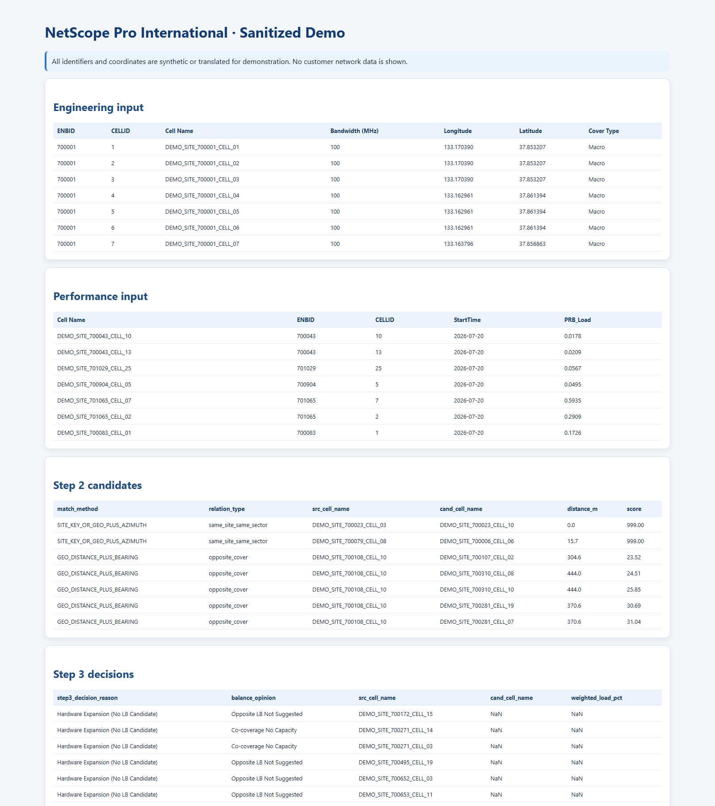
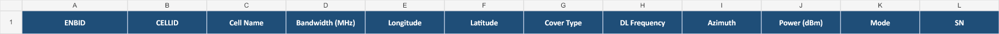
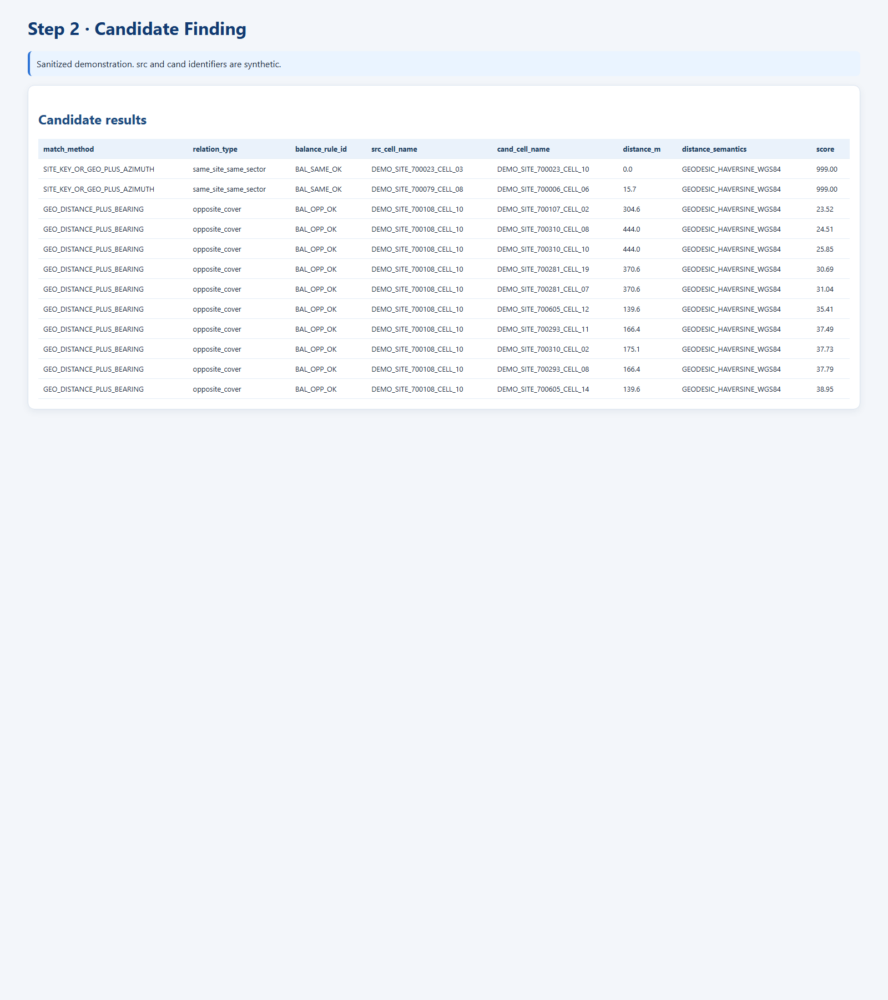
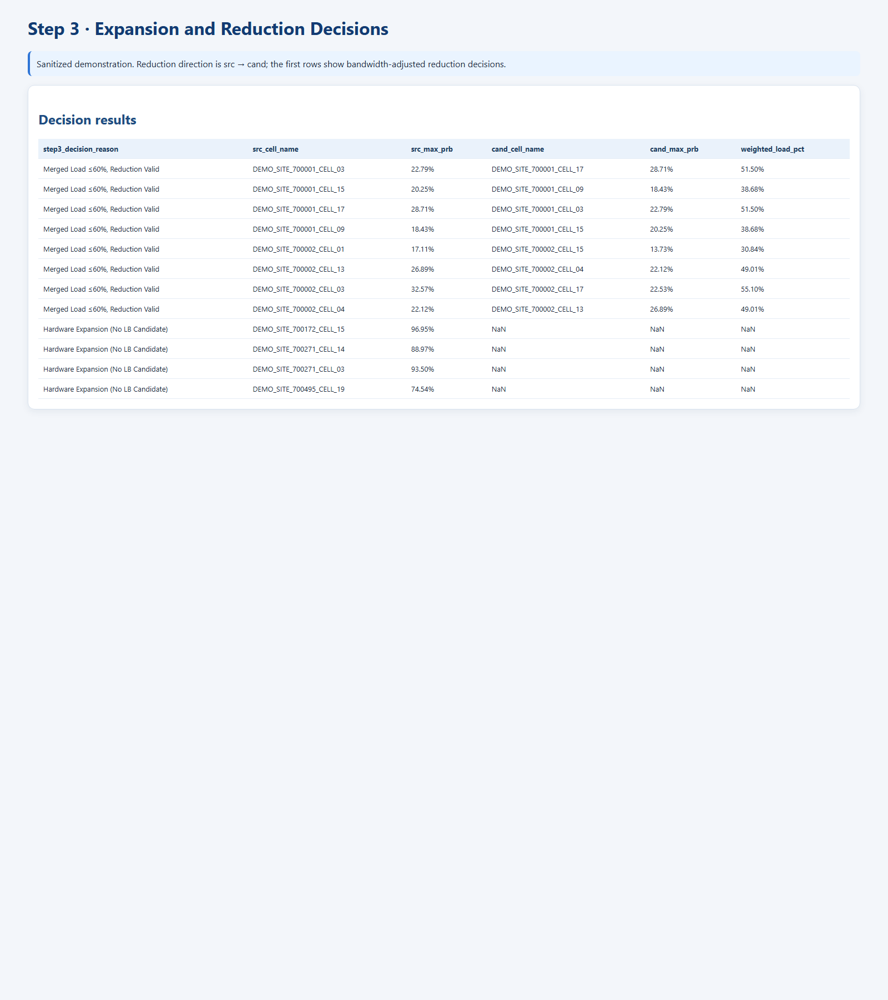
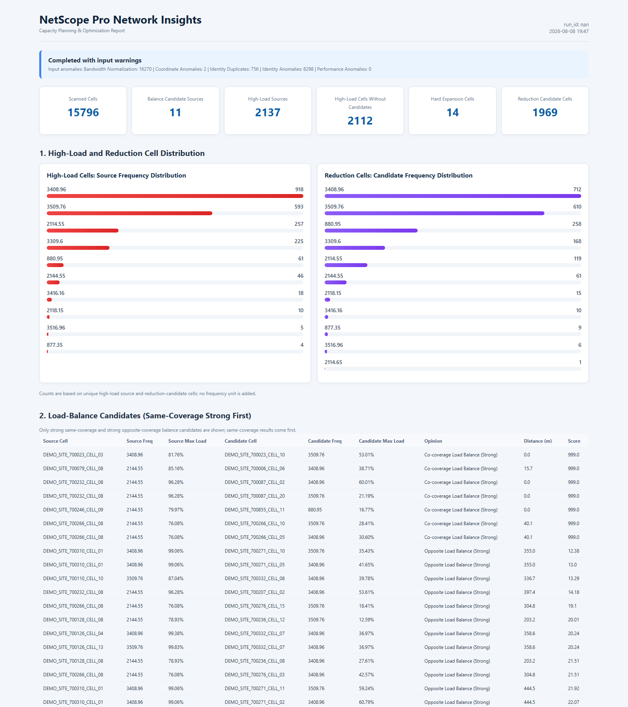

# NetScope Pro International

NetScope Pro v4.22 International is a Windows desktop tool for wireless-network capacity and coverage planning. It analyzes engineering parameters and PRB load data to identify high-load balancing, expansion and reduction candidates.

> This public repository contains documentation, input templates and a sanitized demo. The core source code is not included. Windows EXE files are separate release assets; check the release notes for the exact build and its status.

## Who is it for?

- RAN planning and optimization engineers
- Network operations and performance teams
- Wireless engineering service providers
- Teams reviewing multi-band, multi-site capacity and reduction opportunities

It is designed for engineers who already have engineering parameters and PRB/KPI data but need a repeatable, auditable way to turn them into candidate actions. It is a decision-support tool; final engineering and implementation decisions remain subject to human review.

## What pain points does it address?

- **Large tables are difficult to review manually:** Step 1 normalizes and audits Excel/CSV inputs before analysis.
- **Candidate relationships are easy to miss:** Step 2 exposes same-site, co-coverage and opposite-coverage relationships using distance and azimuth evidence.
- **Reduction decisions can ignore bandwidth differences:** Step 3 shows the source-to-candidate direction and applies bandwidth-adjusted merge-load checks.
- **Results are hard to explain later:** Step 4 provides readable result tables, an HTML report, audit information and run metadata.
- **International data formats vary:** the International Edition documents WGS-84 coordinates, MHz bandwidth formats and ratio/percent PRB input rules.

## Quick start

1. Open the application and choose **Export Input Templates**.
2. Fill in the English engineering and PRB load template files.
3. Import the engineering file and the load file on **Run Analysis**.
4. Review the parameters and click **Start Analysis**.
5. Open the result directory and review the CSV and HTML report. A production run also includes the data-quality audit workbook and run metadata; the public demo package intentionally contains only sanitized result samples.

## Input templates

- [Engineering template](templates/en/Network_Cell_Info_Template.xlsx)
- [PRB long-format template](templates/en/PRB_Load_Data_Long_Template.xlsx)
- [PRB wide-format template](templates/en/PRB_Load_Data_Wide_Template.xlsx)
- [Complete offline user guide](README_EN.html)
- [Sanitized demo inputs and Step 2–Step 4 results](demo/)

The engineering template uses WGS-84 longitude/latitude in degrees. Bandwidth accepts numeric MHz values such as `20`, `20.00`, `20M`, `20MHz` and `20 MHz`. PRB values accept ratios such as `0.7` and percentages such as `70%`.

### Engineering template

### Performance data formats

Long format stores one cell-day record per row. Wide format stores one cell per row with dates as columns.

## Main analysis stages

- **Step 1 — Data Prep:** validates workbook structure, coordinates, bandwidth, PRB values, dates, duplicates and cell identity.
- **Step 2 — Candidate Finding:** identifies same-site and opposite-coverage candidates using geodesic distance, azimuth and load rules.
- **Step 3 — Decisions:** performs final expansion/reduction checks, including bandwidth-adjusted reduction calculations.
- **Step 4 — Reports:** generates public result tables, audit information and an HTML report.

Every reduction record follows the direction **src → cand**: `src` is retained to carry the load, while `cand` is evaluated for reduction.

## What the results look like

### Step 2 — Candidate results

Step 2 answers: **which cells are geometrically or logically related, and why are they candidates?** The result exposes the match method, relation type, source/candidate names, distance semantics and score.

- [Open Step 2 candidate sample CSV](demo/outputs/2_Load_Balancing/candidates_sample.csv)

### Step 3 — Expansion and reduction decisions

Step 3 answers: **which candidate becomes an expansion, balancing or reduction decision after load and bandwidth checks?** The reduction direction is always `src → cand`.

- [Open Step 3 decision sample CSV](demo/outputs/3_Expansion_Reduction/step3_decisions_en_sample.csv)

### Step 4 — Final report

Step 4 presents the result for review: summary metrics, high-load and reduction distributions, balancing details, expansion/reduction details, data-quality information and run status.

- [Open the sanitized Step 4 HTML report](demo/outputs/4_Final_Reports/Network_Report_demo.html)
- [Open the complete sanitized demo package](demo/)

## Output and license modes

The application has Trial, Free and Pro output controls. Trial duration depends on the build. After Trial expiry without a valid license, Free mode limits each detailed result table to the first 100 deterministic rows while retaining complete summary counts.

Valid annual activation unlocks complete detailed output. The EXE and license state are distributed separately from this documentation repository.

## Interface reference

For all parameter descriptions, validation rules, anomaly handling and result interpretation, open the [English offline user guide](README_EN.html). The repository homepage uses the sanitized demo preview above; it does not display local file paths or historical license-status screenshots.

## Sanitized demonstration

The [`demo/`](demo/) folder contains English demo workbooks, sanitized Step 2 candidates, Step 3 decisions, a Step 4 HTML report and a visual preview. Identifiers and coordinates are synthetic or translated, so the package can be used for product demonstrations without exposing customer network data.

## Repository boundary

Included: English documentation, screenshots and input templates.

Excluded: core Python source, EXE binaries in the repository tree, runtime configuration, license keys, customer data, analysis outputs and build artifacts. Release binaries may be attached separately to a public GitHub Release. The executable used in the recent payment, email delivery and activation check is different from the executable attached to the current GitHub Release; that check does not validate the GitHub asset.
