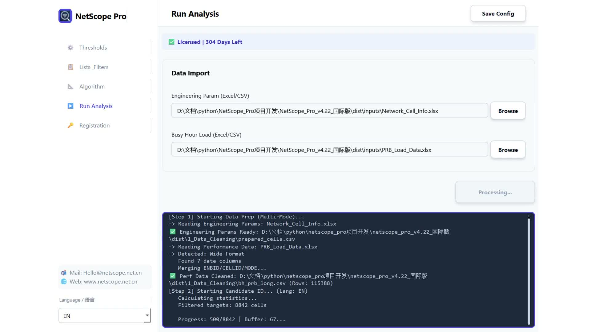
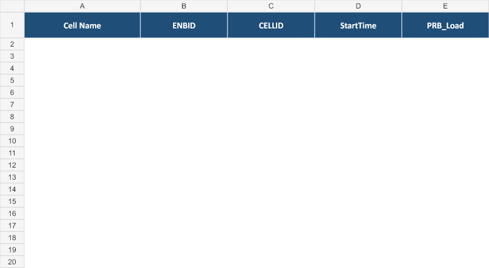
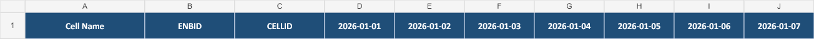
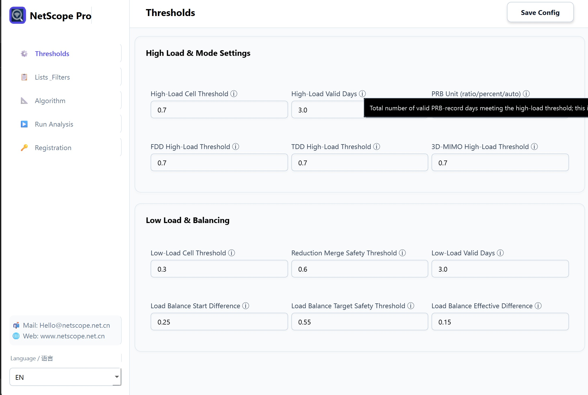

# NetScope Pro International

NetScope Pro v4.22 International is a Windows desktop tool for wireless-network capacity and coverage planning. It analyzes engineering parameters and PRB load data to identify high-load balancing, expansion and reduction candidates.

> This repository is private. The core source code is not distributed here. The application is delivered as a closed Windows EXE with Trial / Free / Pro output controls.

## Quick start

1. Open the application and choose **Export Input Templates**.
2. Fill in the English engineering and PRB load template files.
3. Import the engineering file and the load file on **Run Analysis**.
4. Review the parameters and click **Start Analysis**.
5. Open the result directory and review the CSV, audit workbook and HTML report.

## Input templates

- [Engineering template](templates/en/Network_Cell_Info_Template.xlsx)
- [PRB long-format template](templates/en/PRB_Load_Data_Long_Template.xlsx)
- [PRB wide-format template](templates/en/PRB_Load_Data_Wide_Template.xlsx)
- [Complete offline user guide](README_EN.html)
- [Sanitized demo inputs and Step 2–Step 4 results](demo/)

The engineering template uses WGS-84 longitude/latitude in degrees. Bandwidth accepts numeric MHz values such as `20`, `20.00`, `20M`, `20MHz` and `20 MHz`. PRB values accept ratios such as `0.7` and percentages such as `70%`.

### Engineering template

### Performance data formats

Long format stores one cell-day record per row. Wide format stores one cell per row with dates as columns.

## Main analysis stages

- **Step 1 — Data Prep:** validates workbook structure, coordinates, bandwidth, PRB values, dates, duplicates and cell identity.
- **Step 2 — Candidate Finding:** identifies same-site and opposite-coverage candidates using geodesic distance, azimuth and load rules.
- **Step 3 — Decisions:** performs final expansion/reduction checks, including bandwidth-adjusted reduction calculations.
- **Step 4 — Reports:** generates public result tables, audit information and an HTML report.

Every reduction record follows the direction **src → cand**: `src` is retained to carry the load, while `cand` is evaluated for reduction.

## Output and license modes

The application keeps full analysis input and summary statistics in Trial, Free and Pro modes. After Trial expiry without a valid license, Free mode limits each detailed result table to the first 100 deterministic rows while retaining complete summary counts.

Valid annual activation unlocks complete detailed output. The EXE and license state are distributed separately from this documentation repository.

## Interface reference

For all parameter descriptions, validation rules, anomaly handling and result interpretation, open the [English offline user guide](README_EN.html).

## Sanitized demonstration

The [`demo/`](demo/) folder contains English demo workbooks, sanitized Step 2 candidates, Step 3 decisions, a Step 4 HTML report and a visual preview. Identifiers and coordinates are synthetic or translated, so the package can be used for product demonstrations without exposing customer network data.

## Repository boundary

Included: English documentation, screenshots and input templates.

Excluded: core Python source, EXE binaries in the repository tree, runtime configuration, license keys, customer data, analysis outputs and build artifacts. Verified release binaries may be attached separately to a private GitHub Release.
